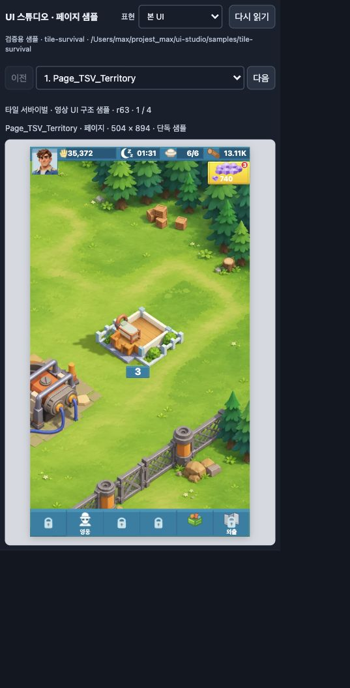
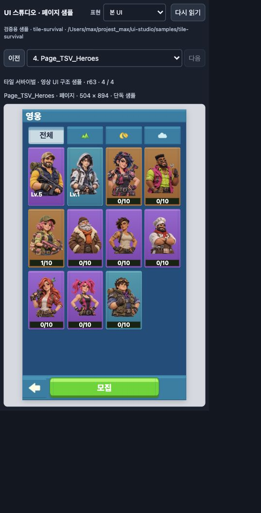

# 타일 서바이벌 참고 샘플 제작
작성자 codex(단이) · 2026-11-18 12:52 KST · 상태 진행/제안(검수 대기)

현중 원문: “타일 서바이벌이라는 게임인데..이 게임도 샘플 데이터로 만들어”. 첨부 로컬영상1~4는원본보존/읽기전용, UI스튜디오 samples/tile-survival로 별도분리합니다. 직전홈보고20261118_1231은 .35/664회귀/실화면마감, 별도새단위입니다.

제작순서: 4영상관찰/타임코드UI목록 → 기존유사레이아웃샘플의실제데이터먼저제시 → 새그림/텍스트·입력·프레임분리와규격/계층계획 → 툴직접조립/저장 → 상태/연결/재열기/반응형검수. 없는입구는미정으로유지합니다. 영상동작과Unity설정추정은구분하며원본게임전체동등/실제게임구현으로보고하지않습니다.

root영상1/2·대상등록/조립·공용보고, 하위영상3/4분석과기존샘플데이터매칭을병행합니다. 2차RoyalMatch/Capy/LSB설정과경로를분리. 새서버/설치/자동화/7007변경없음,샘플JSON직접조작금지. 읽은원본과추출기/후보는 _작업/codex/ux-studio/tile-survival-20261118/ 에보존합니다.

실제조립/캡처/시험/백업/미확인·다음은이보고에갱신합니다.

## 13:39 KST · 분석·첫 영지 조립 중간
4영상의31고유가족(13screen/8modal/4sheet/6overlay), 별도참고연출3/공유부품군4를 통합했습니다. 31은 실제조립수가 아닙니다. 정적조사서와51개 원본시점JPG는 samples/tile-survival/docs/reference/ 및 내장가이드 reference/tile-survival-video-20261118/에58파일씩 보존했습니다. 자료검사1128/1128(동일검사 각사본,합산안함), 링크/원본시간/해시 대조를 하위가 수행했으며 본체 브라우저는 다음 검수입니다.

실제 macOS폴더선택→독립UI→새 workspace-76e57701-a74e-4e37-a4f6-9e83c12cd6fc / ux-25ecc98a를 만들었습니다. 현재native r8·Page_TSV_Territory 1화면10부품0연결: 새영지그림,9슬라이스상단바,그림4/숫자3/부모HUD로조립. 원본504×894기준논리좌표를사용하며 원본캡처를production에넣지않았습니다. 정적카탈로그의r6/8부품은통합시점스냅샷이며현재보다이전입니다. 실제임포트·이름·위치·숫자는제품UI/Tab확정·저장으로작성했습니다.

새원화준비: 영지1/사령관1/온실실내1/영웅13(전신2+서로다른초상11),직접작성기하8. 준비파일수를제작화면수로세지않습니다. native등록과실제표시/미등록을분리합니다. 사용될자원은300KB이하WebP이며alpha/tightcrop/hash를보존합니다. Capy r90실제504×894/HUD504×64/Nav504×108 및Equipment/Chests 자료를재사용후보로먼저제시했습니다. 원본타일영역/건물시트/4열영웅목록과차이를기록했습니다.

2차Royal r36전후저장안전시점을받고정적Royal/Tile조사서진입행만 project-research.json에등록했습니다. 현재공통main.mjs/styles.css는13:25이스라트부품설명추가로변경된STATUS를확인했으며본체Tile작업에서는수정하지않았습니다. 탭전환/clipboard초기화의원인은미정이고이번JSON등록이전사건입니다. 2차설계/그림/LSB설정은수정하지않습니다.

백업: docs/planning/_backup/20261118_단이/133938_tile_catalog_registration 및1310_tile_territory/r1. 새논리UI제작·상태/연결/재열기/1440·430실화면/최종캡처는진행중이며완료라하지않습니다。W/P/U/S0/4·원본전체동등미검수·게임3D/판정/API미구현. 다음은첫영지HUD/이동입구·건물판틀조립입니다.

## 최종 native 조립·실화면 검수 (2026-11-18)
저장 ux-25ecc98a r63, 4화면219부품5연결을 실제 제품 편집으로 구성했습니다. Page_TSV_Territory50 / Page_TSV_BuildingInterior48 / Modal_TSV_BuildingUpgrade43 / Page_TSV_Heroes78입니다. 분석31가족 중4가족의 부분조립이며27가족은 원본·부품·상태 명세만 있습니다. 전체동등0/31·대표W/P/U/S0/4를 유지합니다. 생산에 원본 화면캡처를 덮어넣지 않았습니다.

world→building→upgrade overlay와 배경inert, Escape시building focus복귀, Confirm Enter→world, Heroes→목록, Back Space→world의6시나리오(고유5연결+닫기) 통과했습니다. 확인 버튼은 연결시험이며 비용차감·3초타이머·게임서버 호출이 아닙니다. 단독 sample-preview는 탐색동작을 실행하지 않고 저장된 한 화면만 보입니다. 모달 저장데이터에는 뒤 화면/HUD가 없습니다.

정적 4화면×2크기8상태의 CSS1440×900/430×844에서 pending이미지0·broken이미지0·가로넘침0·stage밖넘침0을 DOM으로 확인했습니다. 최초 빠른 캡처 일부에서 장면 paint 전 프레임이 기록되어 채택하지 않았고, 화면선택 후 별도 관찰 호출에서 캡처를 다시 보존했습니다. 채택 JPG desktop 실제1800×1125/CSS1440×900, mobile 실제537×1055/CSS430×843(픽셀반올림)이며 파일명만으로 크기를 주장하지 않습니다. 브라우저 viewport capability를 새로 얻은 뒤 적용 정상, source수정0. docs/evidence/20261118-tile-survival/browser-verification.json 및 capture-metadata.json에 기록했습니다.

Hero 태블릿768×1024→논리504×672에서 목록468×472/content560/PageDown 실제scrollTop87.5, 카드11개111×180을 유지했습니다. 폰390×844→논리504×1091/목록H891, 큰폰430×932→논리504×1092/H892이며 이미지실패0. native 버튼상태 미리보기는 모집 버튼의 normal색행렬1→pressed0.741176→disabled0.6→normal1 복귀를 확인했습니다. 이 샘플은 색변화 방식이며 상태별 새 그림/입체 눌림 원화는 등록하지 않았습니다.

r57에서4HUD자원프레임의기본백판이 실제화면에서 보여, slice/edge/padding을 먼저 지정하고 경로임포트 완료 이미지를 확인한 후 다음선택으로 이동하여 r58에 native수정했습니다. r63 실제42skinframe 모두 custom normaltexture등록/missing0, 그림자20개는 engine효과입니다. native-review-v002는r57/47참조 과거검사로보존하며 r63/48참조와혼동하지않습니다. BuildingLevel자식의6px돌출도r59 native교정했습니다.

이번 npm test 전체673/673·fail0·cancelled0·skipped0·exit0을 실제재실행했습니다. 로그 _작업/codex/ux-studio/tile-survival-20261118/final-tests.log. 홈의 타일서바이벌 r63카드→샘플보기 진입과4화면선택을 확인했습니다. 타일에서 공통JS/CSS수정0·서버조작0·7007변경0. 현재설계파일은r63저장상태, 가이드/카탈로그최종동기화와독립읽기검토를남깁니다.

미완료: 필터실동작·모집/영웅상세·27가족native조립·원본서체/Unity설정·3D/전투/게임수급/API·원본동등/사용자최종승인. 신규그림은컨셉재제작이며원본픽셀동일로세지않습니다.

Backup: docs/planning/_backup/20261118_단이/152658_tile_final_evidence
Recorded KST: 2026-11-18T15:26:58.602019+09:00

## 최종 배포 정리 · 1차 샘플 데이터 등록 / 제안(검수 대기)
공통 가이드2026-11-18.36/16문서의 ‘타일 서바이벌 분석·제작 가이드’를 실제 메뉴에서 읽었습니다. samples/tile-survival/docs/PRODUCTION_GUIDE.md, docs/reference/의31가족·52참조시점과 내장 guide/reference/tile-survival-video-20261118/를 함께 보존했습니다. GUIDE index는 루트 대문자 MD 파일명만 받으므로 하위경로를 직접등록한 초기시도의 목차형식 오류를 확인했고, 기존 계약에 맞는 TILE_SURVIVAL_GUIDE.md로 정정했습니다. 엔진/보안계약은 바꾸지 않았습니다. 정정 전 index는1531_tile_guide_index_fix에 보존했습니다.

본체 최종 자료검사는 각 카탈로그 후보/샘플/내장사본에서 python3 <해당경로>/verify_catalog.py --no-write로1251/1251·실패0(15:34:42 KST), 동일검사라 합산하지 않습니다. 과거1128/1249는 당시 스냅샷입니다. 생산가이드3배치 각각 상대링크43개 누락0, 공통목차16개 파일존재/파일명규칙 통과. 최종 목차/홈/저장 관련 node --test mount.test.mjs workspace-store.test.mjs home-entry.test.mjs home-ui.test.mjs home-data.test.mjs 43/43·실패0·exit0; 로그 guide-publish-tests.log. 이43은 전체673과 중복되는 관련회귀이며 합산하지 않습니다.

카탈로그 실제 브라우저: 31article, CSS1440×900 및430×843 가로넘침0/관찰broken0. 화면밖 lazy46이미지는 미요청 상태이므로 전체52HTTP완료로 쓰지 않습니다. 원본52JPG의 존재/SHA/치수는 정적검사 결과입니다. 실제 필터는 TS31검색2(관련목적지문구를포함한전체텍스트검색), modal8, TSV04영상2를 확인했습니다. 검색기본값을복원했습니다. 각페이지 단독샘플과 catalog 내용은 서로 다른 산출입니다.

독립 하위 최종읽기검토: r63 validator통과/219부품·5연결·부모누락/순환/중복ID·이름0·빈글자0·image+skin동시잔여0. native문자55·독립이미지51, skin42/누락0, 고유48자원SHA불일치0 및93참조 sourceSize/실제WebP치수불일치0. nav6×84×64/가구4×110×170/영웅11×111×180 일치. 부모밖 NEW의 의도한위2px만 남고 모달직속Sheet외복제배경0. 참고52캡처와등록48자원의동일SHA/디코딩픽셀0이며새그림임을도상으로확인했습니다. 이 검토는읽기전용이며GUI/HTTP/673회귀재실행결과가아닙니다.

최종 저장 JSON SHA256=3411e858552f46daac63ceb2a23de6da680cd3e294234435f619c0ea8fea3df4. 기존Mono r354/Capy r90는이번샘플시작의provenance해시와동일한지최종manifest에서대조합니다. Royal은2차가변경중이므로불변을주장하지않습니다. guide/index/AI_GUIDE/PROGRESS와정적 project-research 등록외본체공통JS/CSS변경0. 7018소유서버재시작/빌드/새패키지/7007/원본영상변경0·자동화PAUSED 유지. 지도갱신: import/export/코드모듈변경0,정적reference등록만이며코드관계지도재생성대상없음.

관련 원본과 근거: samples/tile-survival/ui-studio/designs/ux-25ecc98a.json:1, src/tools/uxStudio/project-research.json의Tile/Royal등록행, 공통guide/index.json .36및TILE_SURVIVAL_GUIDE.md, sample/docs/PRODUCTION_GUIDE.md, catalog/native-actual-r63.json, catalog/sample-evidence.json, sample-match/inventory.json, 각asset authoring manifest/원화/PNG/WebP. 영상전체4개의모든프레임을전수재생한것은아니며coarse+전환세부관찰로가족을목록화했습니다.

진입: 7018 /ui-studio/ → 샘플 보기 → 타일 서바이벌 r63 → 저장샘플4화면. 편집/동작시험은동일workspace/project로별도진입,공통가이드메뉴에서타일제작규칙. 처음받은로컬4영상은읽기만,샘플원본/구형자원/과거판은보존합니다. 2차Royal/Capy와소스·자원을분리하고.36가이드및AX관찰실패와정상DOM지원의차이를지식공유했습니다. 다음은TS09챕터노트/TS22모집·TS26영웅상세/TS19전투편성등아직없는독립판틀의원본·유사샘플데이터를다시대조한뒤native조립하는후속단위입니다.

이번 결과는 ‘1차 샘플 데이터 등록’입니다. 31유형전체native제작완료/게임구현/전체동등/정책승인은아닙니다. 전체동등0/31·W/P/U/S0/4 유지, 사용자최종결정대기. 미조립27/미연결모집/표시전용필터/원본정확서체·Unity·게임API는남은작업으로보존합니다. 커밋없음(독립폴더비Git).

KST final record: 2026-11-18T15:39:04.881450+09:00
Backup: docs/planning/_backup/20261118_단이/153904_tile_report_finalize

