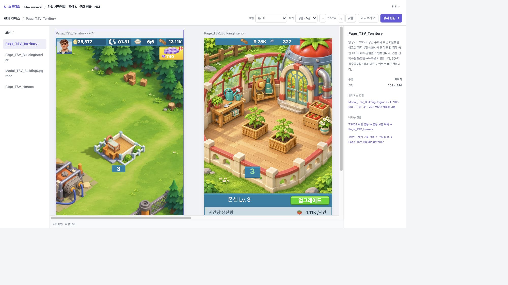

# 홈 샘플 진입·전체 캔버스 복귀 수정
작성자 codex(단이) · 상태 진행/제안(검수 대기)

지시: 현중 “여기서 샘플 보기 누르면 처음 전체 메인 페이지는 어떻게 가지? 지금 링크가 잘못 된것 같은데..” 및 샘플카드화면.
원인: home.mjs card가 designURL('sample')로 단독뷰를 열고 sample-preview 헤더에는 시작홈만 있어 샘플 전체캔버스 입구가 없습니다.
이번 설계: 홈 ‘샘플 보기’→동일workspace/project의 기존 overview(canvas.html). 단독뷰에는 ‘전체 캔버스’ 링크를 두고 현재화면·표현을 유지. 읽기실패/잘못된주소는역링크숨김. 홈에 새보조버튼을늘리거나샘플데이터를고치지않습니다. 기존 단독뷰/동작시험역할은유지합니다.
원본: AGENTS/협업README/STATUS끝30줄/최근본체보고5개, home/home-data/overview-layout/sample-preview/관련tests 및 common.36 가이드. Graphify root지도없음,관련모듈직접범위검색. 보호파일/7007/다른게임/2차저장데이터/서버조작0.
검증계획: 실제홈카드재현→회귀RED→최소소스수정→관련/전체시험→홈샘플4카드/선택유지복귀1440·430실화면·캡처. 데이터/스키마와원본샘플해시는보존합니다. 2차Royal 저장완료/HMR안전회신받음.

KST: 2026-11-18T15:59:19.150723+09:00
Backup: /Users/max/projest_max/ui-studio/docs/planning/_backup/20261118_단이/1559_home_navigation

## 검수 마감 · 연결 수정 / 제안(검수 대기)
홈 카드 원인은 home.mjs:78의 designURL('sample')이었습니다. 같은공통builder의overview를사용하도록바꾸었습니다. 단독viewer는sample-preview.mjs:11/78/88에서overviewURL을재사용하고로드성공후에만링크를보이며현재screen/view를매번sync합니다. HTML:2/3에접근가능한‘전체캔버스’앵커와모바일wrap스타일을추가했습니다. 화면단위전용코드/설계JSON수정은없습니다.

RED:home-ui와새sample-overview-navigation 실제8개중3fail(단독주소로연결/복귀입구누락)→최소수정후8/8pass. 신규4회귀는선택화면·표현/저장갱신,legacyworkspace생략,invalididentityfetch0,404시타설계fallback금지입니다. 이번npm test677/677fail0/cancelled0/skipped0·exit0. red-tests.log/full-tests.log 및실화면증거는작업·evidence폴더에보존했습니다.

실제 홈4카드의href가모두canvas.html+각workspace/project임을확인했고Tile실제클릭→전체4화면목록r63으로진입했습니다. 캔버스에서Heroes/세부와이어선택→미리보기새탭→조건창/와이어전환→전체캔버스링크클릭으로동일workspace/project/조건창screen/wireframe표현을유지해복귀했습니다. UI표현을원복했습니다. 단독viewer복귀링크CSS1440×900/430×843에서가로넘침0·링크화면밖돌출0·실제표시를확인했습니다. 캡처 실제픽셀은capture-metadata.json에따르며요청크기와혼용하지않습니다. viewport는2차RoyalQA와시간을조율하고검수후reset했습니다.

가이드.37의START_PROJECT_GUIDE/PROGRESS에홈샘플→전체캔버스→미리보기→전체캔버스/시작홈차이를기록했습니다. 기존프로젝트guide사본보존. Graphify독립root지도없음,새파일모듈0·기존sample-preview→overview-layout import추가만문서에기록. 2차에는HMR완료/677검수/viewport반환을전달했습니다. 다른프로젝트/7007/서버재시작/빌드/설치/자동화0.

기존Mono r354/Capy r90/Tile r63의작업시작SHA를마지막에재확인해동일합니다. 새게임·샘플시각제작은이링크수정범위가아니며현중추가요청클래시샘플은별도보고1614에이어갑니다. 킹샷은2차배정,앨범버프정정은즉시취소되어수정0. 사용자최종검수대기·커밋없음.

증거: docs/evidence/20261118-home-navigation/ (browser-checks.json·overview-from-home.jpg·sample-return-desktop.jpg·sample-return-mobile.jpg·샘플SHA검증). 백업1559_home_navigation 및1607_home_navigation_guide. 결과문서와동명JPG는전체캔버스실제원본사본입니다.

