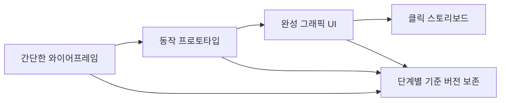

# UI 스튜디오 · 제작 단계와 Unity 구조

**이 문서는** 간단한 와이어프레임부터 동작 프로토타입과 본게임 UI까지 이어 만드는 제작 구조의 조사·구현 순서입니다.
**보는 법** 목표 → 현재 차이 → 구현 순서 → 수락 기준 순서입니다.
**지금 상태** 현재 개발되지 않음, 진행 중. 아래 미구현을 완료로 표시하지 않습니다.

## 목표와 최신 직접 지시
현중: “와이어 프레임을 간단하게 짜고 … 프로토 타입 … 다시 본게임 ui까지 … 유니티 ui툴과 똑같은 구조 … 서두르지 말고 차근 차근 조사 잘하고”.
대표 샘플은 Figma 모노폴리 GO 화면. 내장 3D만 제외하고 2D 그림·아이콘·프레임·문자·색·그림자·배치·입력·상태 및 시각 품질까지 재현합니다. 필요한 그림 제작을 포함합니다. 기존 우리게임3화면 제안은 보존하되 대표샘플보다 먼저 강행하지 않습니다. 전체 스크린샷 한 장을 덮는 방식은 부품 조립 검증을 대신하지 못합니다.

## 제작 흐름

같은 요소 ID·부모 계층·화면 연결을 유지하면서 표현과 동작을 확장합니다. 각 단계에서 비교 가능한 기준 버전을 별도로 남깁니다. 구조/게임 보기 전환만으로 세 단계 완료라 하지 않습니다.

## 현재 구현과 차이
| 영역 | 이번 원본 확인 | 보완할 것 |
|---|---|---|
| 계층 | model.mjs:validateDocument 부모 누락·순환 검사 | Canvas와 부품의 편집 의미·형제 그리기 순서를 명시 |
| 배치 | model.mjs:resolveRect 백분율과 inset | anchorMin/Max·pivot·anchoredPosition·sizeDelta 및 좌표축 변환 |
| 저장 | save-plugin.mjs:saveDocument revision 충돌 거부·이전판 백업 | W/P/U 단계 기준판 식별·조회·복구 계약 |
| 그래픽 | parts/skins의 그림·텍스트·프레임 분리 | 원본 자원 출처·상태별 자원·최종 외형 대조 |
| 본게임 소비 | README에 게임 host 어댑터 없음 명시 | 실제 게임 적용 경계·출력 계약. 현재 게임연동 완료 아님 |

## 한 단위씩 구현할 순서
1. **제작 단계 계약**: 기존 revision과 분리한 단계 표시·기준판 참조. 실제 문서 복구 가능성을 먼저 시험합니다. 저장 API/2MB 제한/동시 저장 거부는 유지합니다. 단계별 전체 이미지를 한 문서에 무한 중첩하지 않습니다. 기존 설계를 자동 변환하지 않습니다.
2. **Unity식 배치**: 순수 좌표 계산을 먼저 만들고 기존 %/inset 경로와 공존하도록 설계합니다. 에디터 이동·크기변경·스냅·소비 렌더러까지 호출부를 조사한 다음 연결합니다. Unity 좌하단 원점과 웹 좌상단 원점의 변환을 명시합니다. pivot 속성만 추가하고 계산을 생략하지 않습니다.
3. **대표 부품 실증**: Figma 원본에서 HUD 한 묶음의 정확한 출처와 부품 자원을 확정합니다. 그림·텍스트·입력영역을 분해하고 필요한 그림을 제작합니다. 관찰 못 한 동작은 추정으로 구분합니다.
4. **입력·상태와 완성 UI**: 누름·선택·비활성·ON/OFF·열기·닫기·복귀를 연결하고 상태별 그림을 적용합니다. 관련 컨트롤의 실제 값/이벤트를 시험합니다.
5. **화면 확장·스토리보드**: 검증한 부품을 대표 화면/모달/상세에 재사용합니다. 우리게임 연결은 이후 별도 허용 범위에서 적용합니다.

## 수락 기준
- 단계 기준판: 이전판 보존, 이후 편집과 독립, 재열기/복구, 충돌 거부, 기존 schema1/2/3 읽기 유지.
- 배치: 부모 크기가 바뀌어도 모서리 고정·중앙 고정·양끝 늘림·중첩 부모가 의도대로 계산. 이동/리사이즈/undo/재열기와 편집·소비 결과 일치.
- 그래픽: 같은 해상도의 원본과 부품 위치·크기·색·글자·상태 비교. 원본 미확보 글꼴/그림은 미확인 목록 유지.
- 실제 조작: 1440/430 편집기와 논리390×844 소비 화면, 이미지404/넘침/입력 겹침/모달 복귀. 잠금 해제 뒤 수행하며 현재 통과로 기록하지 않습니다.

## 조사 근거와 범위
Unity 공식 [RectTransform](https://docs.unity3d.com/Packages/com.unity.ugui@2.0/manual/class-RectTransform.html)은 부모 사각형에 대한 앵커와 피벗을 정의합니다. [Canvas](https://docs.unity3d.com/Packages/com.unity.ugui@2.0/manual/UICanvas.html)는 UI 부모 및 계층에 따른 그리기 순서를 설명합니다. 이번 조회는 uGUI2.0 문서이며 기존 조사main7.0과 구분합니다. 대상 게임의 Unity 버전·실제 Prefab 계층·완전 호환은 미확인입니다.
기획서지도 T04 연결 조회와 최신 T04/요구표/재개/보고, model.mjs·save-plugin.mjs·README를 대조했습니다. 기존 코드지도는 새 UX모듈을 포함하지 않아 최신 구현의 근거로 대신하지 않습니다. 이번은 조사·명세 변경이며 소스/게임/설계 파일/서버를 바꾸지 않았습니다. 실제 UI·자동시험 재실행·캡처도 이번 회차에는 없습니다.
